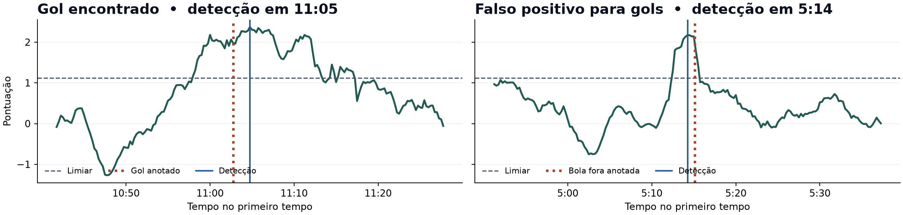

# Ouvindo o gol

INF0413 · Processamento Digital de Sinais e Imagens · UFG

Checkpoint 1 · 13 de novembro de 2026

## Equipe

| Matrícula | Nome completo |
| --- | --- |
| 202503999 | Felipe Orlow de Oliveira Sene |
| 202504023 | Pedro Augusto Ferreira Matos |
| 202504021 | Murilo Uchôa Lima |
| 202505701 | Gustavo Henrique Barros da Silva |

## Apresentações

- [Prévia do seminário em 06/11](../slides/Ouvindo%20o%20gol%20%E2%80%94%20Pr%C3%A9via%20do%20Semin%C3%A1rio.pdf)
- [Checkpoint 1 em 13/11](../slides/checkpoint-1/Ouvindo-o-gol-Checkpoint-1.pdf)

## Resumo

Em uma transmissão de futebol, os gols ocupam poucos instantes. O projeto investiga a localização desses momentos pelo áudio. O detector inicial combina intensidade sonora, tom e duração. A avaliação usa anotações do SoccerNet e tolerância de ±15 segundos. A regra com bônus de tom encontrou 36 dos 55 gols em 12 partidas. A próxima etapa compara atributos acústicos com representações de áudio de uma rede pré-treinada. O objetivo dessa comparação é a redução dos falsos positivos. O detector já fornece candidatos a clipes.

## Introdução

A reação do narrador a uma finalização ou a um gol pode mudar a intensidade, o tom e o ritmo da transmissão. A torcida e outros sons também entram na trilha, e diferentes lances podem produzir reações parecidas. O projeto investiga em que medida esses sinais ajudam a localizar gols e, como análise complementar, outros lances anotados.

Xiong et al. (2003) investigaram a detecção de eventos sonoros para selecionar melhores momentos de esportes, incluindo futebol. Vanderplaetse e Dupont (2020) mediram o ganho de combinar áudio e vídeo na localização de lances do SoccerNet. Deliège et al. (2021) ampliaram as anotações temporais desse conjunto, que fornece o gabarito do projeto. Usamos pYIN (MAUCH; DIXON, 2014) para estimar o tom no detector inicial. Para investigar padrões que a regra manual deixa passar, propomos usar uma rede PANNs pré-treinada no AudioSet (KONG et al., 2020).

**Objetivo geral.** Localizar candidatos a gols no áudio de partidas e usar seus timestamps para gerar clipes.

**Objetivos específicos.** Medir o desempenho de regras com volume, tom e duração. Comparar as regras com classificadores baseados em atributos acústicos e em representações de áudio pré-treinadas. Analisar acertos e alarmes falsos e, na etapa final, demonstrar a geração de clipes a partir dos timestamps.

## Metodologia

### Dados

O recorte disponível tem **12 jogos completos e 24 tempos** do conjunto oficial de validação do SoccerNet. As anotações usadas contêm **310 eventos** das classes selecionadas, dos quais **55 são gols**. A análise complementar inclui pênaltis, chutes no alvo, chutes para fora, cartões vermelhos e segundos amarelos seguidos de expulsão. Os dois lotes têm seis partidas cada, sem sobreposição. O arquivo de anotações de validação contém 100 partidas. Os 12 jogos do recorte têm mídia disponível para esta avaliação. [SoccerNet-v2](https://www.soccer-net.org/tasks/action-spotting)

### Detector do Nível 0

O áudio da transmissão é convertido para mono a 16 kHz. O detector aplica um filtro de 300 a 3.400 Hz na trilha, calcula a intensidade RMS em dB a partir da STFT e estima a frequência fundamental com pYIN. As medidas são normalizadas por tempo de jogo com mediana e desvio absoluto mediano e suavizadas com uma média móvel de três segundos. Na regra atual, o volume forma a pontuação e uma subida do tom pode acrescentar um bônus limitado. O limiar é o percentil 98 da pontuação daquele tempo de jogo. Trechos acima do limiar por ao menos dois segundos geram candidatos, ordenados pela área da pontuação acima do limiar.


### Avaliação

Cada detecção pode ser associada a um evento ainda sem correspondência a até **±15 segundos** do pico. A precisão é a fração de detecções que acertaram. A revocação é a fração de eventos anotados que foram encontrados. O F1 é a média harmônica das duas medidas. Somamos as contagens por lote antes de calcular as métricas e reportamos todas as detecções e, como análise complementar, os três primeiros candidatos de cada tempo de jogo.

### Próximos modelos

1. **Atributos acústicos.** Treinar um classificador com MFCC, RMS, frequência fundamental e centroide espectral.
2. **Rede pré-treinada.** Testar PANNs CNN14 de 16 kHz como extrator de representações. A proposta é usar janelas de cinco segundos de áudio mono com passo de um segundo. Uma janela positiva contém o timestamp de um gol. As negativas serão coletadas longe de gols e incluirão exemplos difíceis, como finalizações e picos da torcida. Um classificador leve aprende a distinguir as duas classes a partir dos vetores do CNN14.
3. **Comparação.** Usar partidas da divisão de treino para treinamento e ajuste interno. Agrupar janelas positivas vizinhas e usar o pico de pontuação de cada grupo como candidato. Aplicar os modelos ao mesmo recorte de validação, com a mesma classe-alvo, tolerância e regra de associação. Reservar a divisão oficial de teste para a avaliação final. Um estudo adicional com outra transmissão está previsto no cronograma. [Modelo CNN14 de 16 kHz publicado pelos autores](https://zenodo.org/records/3987831)

## Resultados preliminares

A tabela usa a regra de volume com bônus de tom, para gols, com todas as detecções.

| Lote | Jogos | Gols encontrados | Detecções | Precisão | Revocação | F1 |
| --- | ---: | ---: | ---: | ---: | ---: | ---: |
| Primeiro lote | 6 | 22/36 | 115 | 19,1% | 61,1% | 0,291 |
| Segundo lote | 6 | 14/19 | 111 | 12,6% | 73,7% | 0,215 |

[Primeiro lote](../outputs/avaliacao_lote_metricas.csv) · [Segundo lote](../outputs/avaliacao_holdout_metricas.csv)



O gráfico compara dois picos no primeiro tempo de Burnley × Arsenal. O mais forte está próximo do gol anotado. O segundo está próximo de uma anotação de bola fora e é um falso positivo para a classe gol.

## Discussão

A regra localiza uma parte dos gols, mas os alarmes falsos dominam quando todos os picos são considerados. Ao limitar a saída aos três candidatos mais fortes de cada tempo de jogo, a precisão sobe para 38,9% e 27,8% nos dois lotes, enquanto a revocação cai para 38,9% e 52,6%. Esse efeito importa para a geração de clipes, pois uma lista curta reduz o volume para revisão e deixa mais gols de fora.

O filtro atua na trilha inteira e a pontuação pode responder à voz, à torcida e a outros sons. A análise por lote mede a associação entre picos sonoros e eventos anotados. O próximo experimento deve mostrar se o classificador distingue melhor gols de outras situações que também geram picos.

## Conclusão parcial

O detector por regras já gera timestamps e fornece uma referência quantitativa para avaliar os próximos modelos. A precisão observada no recorte disponível indica que reduzir alarmes falsos é o principal objetivo do próximo experimento. A comparação deverá manter o protocolo de avaliação e medir o efeito das novas representações sobre precisão, revocação e F1.

## Como reproduzir a avaliação

Com Python 3.12 ou superior, `uv` e FFmpeg instalados, extraia os dados autorizados na raiz do repositório, de modo que as listas `data/games_valid.txt` e `data/games_valid_holdout.txt` e a pasta `data/soccernet/videos-224p/` fiquem acessíveis. Os comandos abaixo usam os WAVs disponíveis em `data/audio/` ou extraem o áudio dos vídeos quando necessário.

```sh
uv sync --locked
uv run --locked avaliar_lote.py data/games_valid.txt --tol 15 --out outputs/reproducao/avaliacao_lote.csv
uv run --locked avaliar_lote.py data/games_valid_holdout.txt --tol 15 --out outputs/reproducao/avaliacao_holdout.csv
```

Cada execução grava os resultados por tempo de jogo e as métricas agregadas. A repetição nos 24 tempos do recorte reproduziu integralmente os quatro CSVs de referência. Os arquivos de mídia ficam na pasta `data/`, que já está ignorada pelo Git.

## Cronograma

| Data | Marco | Trabalho previsto pelo grupo |
| --- | --- | --- |
| 13/11 | Checkpoint 1 | Proposta revisada e avaliação do Nível 0 nos 12 jogos disponíveis |
| 27/11 | Checkpoint 2 | Resultados parciais do classificador com atributos acústicos e andamento do experimento com PANNs |
| 04/12 | Checkpoint 3 e apresentação final | Comparação dos métodos avaliados e demonstração de clipes gerados a partir dos timestamps |

## Referências

DELIÈGE, Adrien et al. SoccerNet-v2: a dataset and benchmarks for holistic understanding of broadcast soccer videos. In: IEEE/CVF CONFERENCE ON COMPUTER VISION AND PATTERN RECOGNITION WORKSHOPS, 2021. *Proceedings [...]*. IEEE, 2021. p. 4508–4519. DOI: [10.1109/CVPRW53098.2021.00508](https://doi.org/10.1109/CVPRW53098.2021.00508).

KONG, Qiuqiang et al. PANNs: large-scale pretrained audio neural networks for audio pattern recognition. *IEEE/ACM Transactions on Audio, Speech, and Language Processing*, v. 28, p. 2880–2894, 2020. DOI: [10.1109/TASLP.2020.3030497](https://doi.org/10.1109/TASLP.2020.3030497).

MAUCH, Matthias; DIXON, Simon. pYIN: a fundamental frequency estimator using probabilistic threshold distributions. In: IEEE INTERNATIONAL CONFERENCE ON ACOUSTICS, SPEECH AND SIGNAL PROCESSING, 2014, Florença. *Proceedings [...]*. IEEE, 2014. p. 659–663. DOI: [10.1109/ICASSP.2014.6853678](https://doi.org/10.1109/ICASSP.2014.6853678).

VANDERPLAETSE, Bastien; DUPONT, Stéphane. Improved soccer action spotting using both audio and video streams. In: IEEE/CVF CONFERENCE ON COMPUTER VISION AND PATTERN RECOGNITION WORKSHOPS, 2020. *Proceedings [...]*. IEEE, 2020. [Texto dos autores](https://orbi.umons.ac.be/handle/20.500.12907/42318).

XIONG, Ziyou et al. Audio events detection based highlights extraction from baseball, golf and soccer games in a unified framework. In: IEEE INTERNATIONAL CONFERENCE ON MULTIMEDIA AND EXPO, 2003. *Proceedings [...]*. IEEE, 2003. v. 3, p. 401–404. DOI: [10.1109/ICME.2003.1221333](https://doi.org/10.1109/ICME.2003.1221333).
